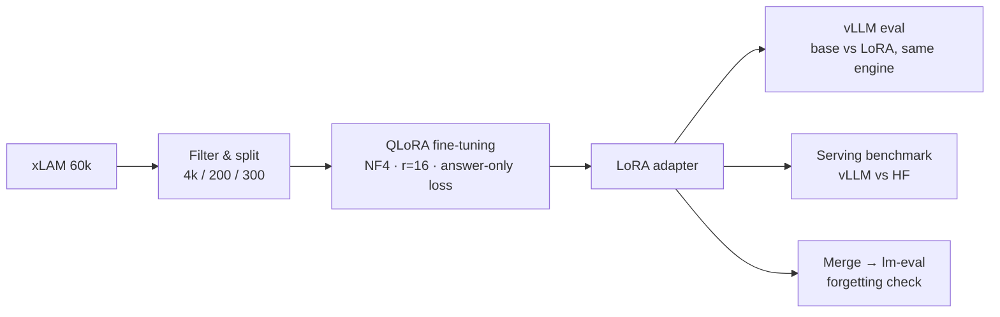

# Function-Calling LLM · QLoRA + vLLM

Fine-tuning a small open LLM to turn natural-language requests into **structured tool calls**, with a reproducible evaluation and serving pipeline that runs end-to-end on a single free Colab T4.

[](https://colab.research.google.com/github/francescodellavalle/llm-toolcalling-qlora-vllm/blob/main/llm_finetuning_toolcalling_vllm.ipynb)


```text
Query  : "What's the weather in Naples and the EUR→USD rate?"
Output : [{"name": "get_weather", "arguments": {"city": "Naples"}},
          {"name": "get_exchange_rate", "arguments": {"from": "EUR", "to": "USD"}}]
```

---

## Results

Held-out test set of 300 examples · greedy decoding · same prompt and parser for both models.

| Model | JSON valid | Tool names match | **Exact match** |
|---|:-:|:-:|:-:|
| Qwen3-1.7B (base) | XX.X% | XX.X% | **XX.X%** |
| Qwen3-1.7B + QLoRA | XX.X% | XX.X% | **XX.X%** |

| Serving (64 requests, T4) | Tokens/s | Speedup |
|---|:-:|:-:|
| HF `generate()` (batch 8) | XXX | 1.0× |
| **vLLM** + LoRA adapter | XXX | **X.X×** |

| General capabilities (lm-eval, 500 ex.) | Base | Fine-tuned | Δ |
|---|:-:|:-:|:-:|
| ARC-Easy (acc) | X.XXX | X.XXX | ±X.XXX |
| HellaSwag (acc_norm) | X.XXX | X.XXX | ±X.XXX |

---

## Pipeline



## Approach

| | Choice | Why |
|---|---|---|
| **Data** | [`Salesforce/xlam-function-calling-60k`](https://huggingface.co/datasets/Salesforce/xlam-function-calling-60k) | Verified labels, single and parallel calls, objective ground truth |
| **Model** | `Qwen/Qwen3-1.7B` (thinking off) | Fits a T4 for both training and serving |
| **Training** | QLoRA: 4-bit NF4 + double quant, LoRA r=16 / α=32 on all projections | ~1 GB of base weights, ~1% trainable parameters |
| **Loss** | Masked prompt, supervised on the tool-call JSON only | The model learns to produce calls, not to copy the prompt |
| **Eval** | JSON validity → tool selection → exact match, order-insensitive | Separates format, routing and argument errors |
| **Serving** | vLLM with multi-LoRA: base and adapter on one engine | Fair comparison and production-style deployment |
| **Regression** | lm-eval-harness on the merged model | Checks for catastrophic forgetting |

## Quickstart

1. Open the notebook in Colab with a **T4 GPU** runtime.
2. Accept the [dataset terms](https://huggingface.co/datasets/Salesforce/xlam-function-calling-60k) and add an `HF_TOKEN` Colab secret.
3. Run all cells. The notebook restarts the runtime twice, to load the vLLM-pinned PyTorch and to free VRAM between training and serving. After each restart, re-run section 1 and continue.

Checkpoints and results are stored on Google Drive, so training resumes automatically if the session drops.

```python
# Use the adapter with vLLM
from vllm import LLM, SamplingParams
from vllm.lora.request import LoRARequest

llm = LLM("Qwen/Qwen3-1.7B", dtype="half", enable_lora=True, max_lora_rank=16)
out = llm.generate(prompt, SamplingParams(temperature=0, max_tokens=384),
                   lora_request=LoRARequest("toolcalling", 1, "path/to/adapter"))
```

## Repository

```text
├── llm_finetuning_toolcalling_vllm.ipynb   # full pipeline
├── results/                                 # metrics, predictions, benchmarks (JSON)
└── README.md
```

## Limitations

- **Format learning inflates part of the gain.** The base model has never seen the output format, so part of the improvement is learning it. JSON validity is reported separately to make this visible.
- **Exact match is strict.** Type mismatches such as `"5"` vs `5` count as errors.
- **Small evaluation subsets** (300 test examples, 500 per lm-eval task) to fit Colab time limits.
- **Precision mismatch.** The adapter is trained on a 4-bit base and served on fp16 weights. The gap is usually negligible but untested here.

## References

- Dettmers et al., *QLoRA: Efficient Finetuning of Quantized LLMs*, 2023
- Hu et al., *LoRA: Low-Rank Adaptation of Large Language Models*, 2021
- Liu et al., *APIGen: Automated Pipeline for Generating Verifiable and Diverse Function-Calling Datasets*, 2024
- Kwon et al., *Efficient Memory Management for LLM Serving with PagedAttention* (vLLM), 2023

---

**Francesco Della Valle** · AI Engineer · [LinkedIn](https://linkedin.com/in/francescodellavalle) · [GitHub](https://github.com/francescodellavalle)
